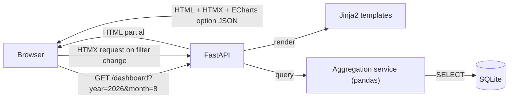
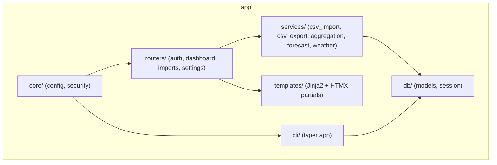

# Architecture

## Tech stack

### Backend
| Concern | Choice | Notes |
|---|---|---|
| Language / runtime | Python 3.13+ | |
| Package manager | `uv` | lockfile-based, fast |
| Lint / format | `ruff` | replaces flake8+black+isort |
| Web framework | FastAPI | also serves server-rendered HTML (Jinja2) |
| Templating | Jinja2 | server-rendered pages + HTMX partials |
| ORM | SQLModel (SQLAlchemy 2.0 + Pydantic) | single source of truth for DB models & validation |
| Migrations | Alembic | |
| Database | SQLite | single file, WAL mode enabled |
| CLI | Typer | `spark-cli` entry point, used to create user accounts |
| Password hashing | `argon2-cffi` | OWASP-recommended KDF |
| Auth token | `PyJWT`, stored in an httpOnly cookie | see [04-auth.md](./04-auth.md) |
| CSV parsing / aggregation | `pandas` | date resampling (day/month/year), stats |
| Localization | `Babel` | locale-aware date/number/month-name formatting (see i18n section below) |
| HTTP client | `httpx` | outbound calls to the weather API (see below) |
| Tests | `pytest` + `httpx.AsyncClient` | |

### Frontend (server-rendered, no separate SPA build)
| Concern | Choice | Notes |
|---|---|---|
| Interactivity | HTMX | partial page swaps for filters (month/year, view toggle) without a JS SPA |
| Charts | Apache ECharts | only mainstream lib with a native **calendar heatmap** coordinate system (needed for the annual "kWh/day" view) |
| CSS | Tailwind CSS, compiled with the **standalone Tailwind CLI** (no Node/npm required) | keeps the whole project Python-only tooling-wise |
| Static assets | Vendored locally under `app/static/vendor/` (htmx.min.js, echarts.min.js) | no runtime dependency on third-party CDNs (security & offline use) |

This is a single Python project: FastAPI serves both the JSON-ish HTMX
fragments and the full HTML pages. There is no separate frontend
repo/build/deploy pipeline.

## Internationalization (i18n)

- **Scope**: only the **web UI** is translated (templates, chart
  titles/axis/tooltips, user-facing messages). Code, identifiers,
  comments, CLI output and logs stay **English-only** — those are
  developer-facing, not part of the translated surface.
- **Supported locales**: English (`en`, reference/default) and French
  (`fr`).
- **Detection**: on every request, the best match is negotiated from the
  browser's `Accept-Language` header against the supported locales
  (Babel's `negotiate_locale`), falling back to English. There is no
  in-app language switcher — users change language via their browser
  settings.
- **String catalogs**: flat key→string JSON maps in
  `app/i18n/locales/en.json` / `fr.json`, loaded once at startup. A
  Jinja2 global `t(key, **kwargs)` looks up the string for the active
  locale and falls back to English on a missing key (never a hard
  error).
- **Locale-aware formatting**: dates, month/day names and number grouping
  use `Babel` (`babel.dates`, `babel.numbers`) rather than hand-rolled
  logic, since the calendar heatmap and monthly charts need correctly
  localized month names (e.g. "Août" vs "August").
- **Charts**: ECharts `option` objects are built server-side
  (`services/`), so chart titles/axis/tooltip strings are produced
  already translated for the active locale, using the same `t()` catalog
  and Babel formatting.

## Weather data

- Daily outdoor temperatures (min/max/average, °C) come from
  [Open-Meteo](https://open-meteo.com/): free, no API key. The geocoding
  API turns the user's city into coordinates; the historical archive API
  returns daily `temperature_2m_min/max/mean`.
- Calls are made **server-side** with `httpx` (15 s timeout) to fixed
  hosts only — the browser never talks to Open-Meteo, so the CSP is
  unchanged. Only the city name and coordinates leave the server.
- Downloads run automatically after each CSV upload (for the newly
  imported days, if a city is configured), when the city is saved, and
  from the "Download temperatures" button on `/settings` (to retry days
  that weren't available yet) — never on page load.
  Long periods are split into requests of at most 366 days, each
  committed on success, so a network failure keeps what was fetched.
- If Open-Meteo is unreachable, the UI shows a warning and nothing else
  breaks: the CSV import itself is already committed and never fails
  because of the weather service.

## High-level request flow

## Module overview

## Security posture (OWASP-oriented)

- **Auth**: no public signup route; accounts created only via CLI
  (`spark-cli create-user`). Passwords hashed with Argon2id.
- **Sessions**: JWT stored in an `httpOnly`, `Secure` (in prod), `SameSite=Lax`
  cookie — never exposed to JS, mitigating XSS token theft.
- **CSRF**: state-changing routes (login, logout, CSV upload) require the
  `HX-Request` header for HTMX-originated calls and a per-session CSRF token
  embedded in forms; `SameSite=Lax` cookies provide a baseline mitigation.
- **File upload**: CSV only, size-limited (see [03-csv-import.md](./03-csv-import.md)),
  parsed with pandas without executing any formula/macro (no Excel), rejected
  if MIME/extension mismatch.
- **SQL injection**: mitigated by using the ORM (SQLModel/SQLAlchemy) with
  parameterized queries; no raw string-built SQL.
- **Secrets**: JWT signing key & CO2 emission factor read from environment
  variables / `.env` (not committed), loaded via `pydantic-settings`.
- **Data isolation**: every table row is scoped by `user_id`; queries always
  filter by the authenticated user (multi-user-safe even though this is a
  personal app).
- **Dependencies**: kept minimal and locked via `uv.lock`; `ruff` catches
  obvious issues; no third-party CDN scripts loaded at runtime.

## Deployment

The production image is published as `ghcr.io/csharplie/spark`. It runs one
Uvicorn process as an unprivileged user and stores SQLite data in a mounted
volume. Alembic migrations run before the application starts. A reverse proxy
must terminate TLS when Spark is exposed outside localhost. See
[09-docker.md](./09-docker.md) for container operations.
