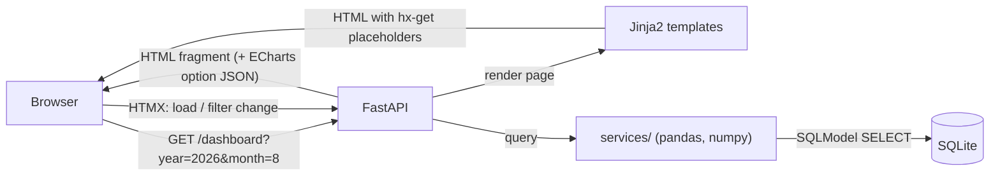
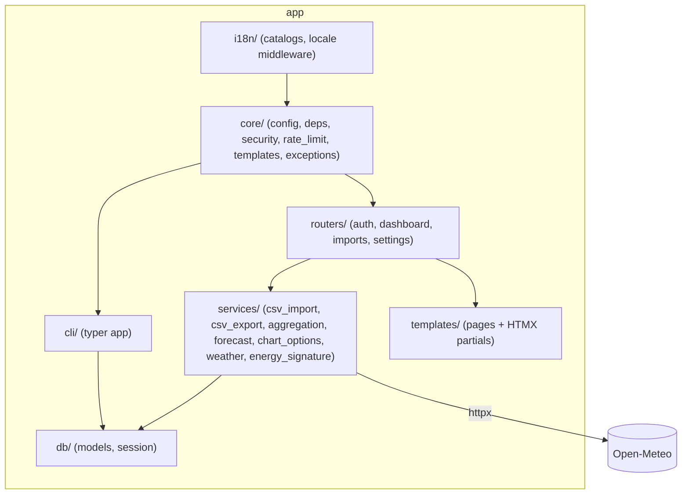

# Architecture

## Tech stack

### Backend
| Concern | Choice | Notes |
|---|---|---|
| Language / runtime | Python 3.13+ | |
| Package manager | `uv` | lockfile-based, fast |
| Lint / format | `ruff` | replaces flake8+black+isort |
| Web framework | FastAPI | also serves server-rendered HTML (Jinja2) |
| Templating | Jinja2 | server-rendered pages + HTMX partials |
| ORM | SQLModel (SQLAlchemy 2.0 + Pydantic) | single source of truth for DB models & validation |
| Migrations | Alembic | |
| Database | SQLite | single file, WAL mode enabled |
| CLI | Typer | `spark-cli` entry point, used to create user accounts |
| Password hashing | `argon2-cffi` | Argon2id, OWASP-recommended KDF |
| Auth token | `PyJWT` (HS256), stored in an httpOnly cookie | see [04-auth.md](./04-auth.md) |
| CSV parsing | Python `csv` module | see [03-csv-import.md](./03-csv-import.md) |
| Aggregation / forecast | `pandas` | daily/monthly/annual rollups, rolling stats |
| Energy signature | `numpy` (comes with pandas) | least-squares fit, see [06-dashboard-views.md](./06-dashboard-views.md#energy-signature) |
| Localization | `Babel` | `Accept-Language` negotiation, localized month names |
| HTTP client | `httpx` | outbound calls to the weather API (see below) |
| Tests | `pytest` + `pytest-asyncio` + `httpx.AsyncClient` | |

### Frontend (server-rendered, no separate SPA build)
| Concern | Choice | Notes |
|---|---|---|
| Interactivity | HTMX | year/month filters re-fetch fragments without a JS SPA |
| Charts | Apache ECharts | only mainstream lib with a native **calendar heatmap** coordinate system (needed for the annual "kWh/day" view) |
| CSS | Tailwind CSS v4, compiled with the **standalone Tailwind CLI** (no Node/npm required) | the compiled `app/static/css/app.css` is committed; see [07-project-structure.md](./07-project-structure.md#tooling) |
| Static assets | CSS, JavaScript, SVG favicon, and locally vendored libraries under `app/static/` | no runtime dependency on third-party CDNs (security & offline use) |

This is a single Python project: FastAPI serves both the full HTML pages
and the HTML fragments fetched by HTMX. There is no separate frontend
repo/build/deploy pipeline and no JSON API.

## Internationalization (i18n)

- **Scope**: only the **web UI** is translated (templates, chart
  titles/legends/axis names, user-facing messages). Code, identifiers,
  comments, CLI output and logs stay **English-only**.
- **Supported locales**: English (`en`, reference/default) and French
  (`fr`).
- **Detection**: `LocaleMiddleware` (`app/i18n/middleware.py`) negotiates
  the locale from the `Accept-Language` header on every request (Babel's
  `negotiate_locale`, in header order — `q` weights are ignored), falling
  back to English, and stores it on `request.state.locale`. There is no
  in-app language switcher and no locale cookie.
- **String catalogs**: flat key→string JSON maps in
  `app/i18n/locales/en.json` / `fr.json`, loaded once at startup (a dev
  server restart is needed to pick up catalog edits). `render()`
  (`app/core/templates.py`) injects `t(key, **kwargs)` and `locale` into
  every template context; `t()` formats with `str.format` and falls back
  to English, then to the key itself, on a missing entry.
- **Formatting**: month names use Babel (`format_date`). Numbers are
  formatted with plain `%.1f`-style formats and dates are mostly shown in
  ISO format — not localized yet.
- **Charts**: ECharts `option` objects are built server-side
  (`app/services/chart_options.py`) with the request's `t()`, so titles,
  legends and series names arrive already translated. Exception: the
  calendar heatmap uses ECharts' built-in (English) month/day labels.

## Weather data

- Daily outdoor temperatures (min/max/average, °C) come from
  [Open-Meteo](https://open-meteo.com/): free, no API key. The geocoding
  API turns the user's city into coordinates; the historical archive API
  returns daily `temperature_2m_min/max/mean` (`timezone=auto`, i.e. days
  in the location's local time).
- Calls are made **server-side** with `httpx` (15 s timeout, client from
  the `get_http_client` dependency) to two fixed hosts only — the browser
  never talks to Open-Meteo, so the CSP is unchanged. Only the city name
  (geocoding) and the coordinates and date ranges (archive) leave the
  server.
- A download fetches every consumption day of the user that has no
  temperature yet. It runs after each non-failed CSV upload (if a city is
  configured), when the city is saved, and from the "Download
  temperatures" button on `/settings` (to retry recent days the archive
  didn't have yet) — never on page load. Long periods are split into
  requests of at most 366 days, each committed on success, so a network
  failure keeps what was already fetched.
- Network/HTTP errors (`httpx.HTTPError`) are shown as a warning. The CSV
  import is committed before the download starts, so it is never rolled
  back by a weather failure.

## High-level request flow

## Module overview

## Security posture (OWASP-oriented)

- **Auth**: no public signup route; accounts are created only via the CLI
  (`spark-cli create-user`). Passwords are hashed with Argon2id. Login is
  rate-limited (10 attempts per client IP per 5 minutes, in memory); three
  failed credential attempts in 5 minutes trigger a 5-minute per-IP cooldown.
- **Sessions**: JWT in the `session` cookie — `HttpOnly`, `SameSite=Lax`,
  `Secure` in production. JavaScript can't read it, which limits (but
  doesn't remove) the impact of an XSS.
- **CSRF**: every state-changing `POST` (login, logout, CSV upload, city,
  temperature download) uses a double-submit token: a random `csrf_token`
  cookie compared, in constant time, with a `csrf_token` form field. Plus
  `SameSite=Lax` cookies. See [04-auth.md](./04-auth.md#csrf).
- **File upload**: `.csv` extension (case-insensitive) and 5 MB limit
  checked before parsing; parsed as plain text with the `csv` module, so
  no formula/macro is ever evaluated. No MIME-type check.
- **SQL injection**: all application queries go through SQLModel/SQLAlchemy
  with bound parameters. The only literal SQL is two fixed `PRAGMA`s run
  on connect (`journal_mode=WAL`, `foreign_keys=ON`).
- **Response headers** (`app/main.py`): `X-Content-Type-Options: nosniff`,
  `X-Frame-Options: DENY`, `Referrer-Policy: strict-origin-when-cross-origin`,
  and `Content-Security-Policy: default-src 'self'; script-src 'self';
  style-src 'self' 'unsafe-inline'; img-src 'self' data:; base-uri 'self';
  frame-ancestors 'none'` (`'unsafe-inline'` styles are needed by ECharts
  tooltips). In production only: `Strict-Transport-Security:
  max-age=63072000; includeSubDomains`, and the FastAPI `/docs`, `/redoc`
  and `/openapi.json` endpoints are disabled.
- **Secrets & settings**: JWT signing key and other settings come from
  `SPARK_*` environment variables / `.env` (not committed), loaded via
  `pydantic-settings`.
- **Data isolation**: every user-owned table (`import_batch`,
  `consumption_record`, `daily_temperature`) carries a `user_id`, and every
  request-time query filters by the authenticated user. Only login and
  the admin CLI look users up by username.
- **Dependencies**: kept minimal and locked via `uv.lock`; no third-party
  CDN scripts loaded at runtime.

## Deployment

The production image is published as `ghcr.io/csharplie/spark`. It runs one
Uvicorn process as an unprivileged user and stores SQLite data in a mounted
volume. Alembic migrations run before the application starts. A reverse proxy
must terminate TLS when Spark is exposed outside localhost. See
[08-docker.md](./08-docker.md) for container operations.
