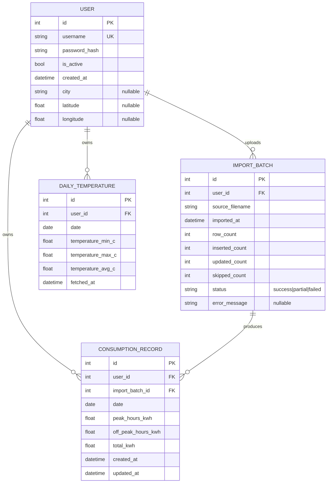

# Data model

## Entity-relationship diagram

## Tables

Models live in `app/db/models.py`; the schema is managed by Alembic
(`alembic/versions/`). Defaults (`created_at`, counters, `status`…) are
set by the Python models, not by SQL `DEFAULT`s, and there are no SQL
`CHECK` constraints. Timestamps are stored in UTC.

### `user`
- One row per human account. Created exclusively via the CLI (see
  [04-auth.md](./04-auth.md)).
- `username`: unique.
- `password_hash`: Argon2id hash, never the plaintext.
- `is_active`: `false` blocks login and existing sessions.
- `city`, `latitude`, `longitude`: the user's location, set from the
  Settings page (geocoded via Open-Meteo; `city` is the display name,
  e.g. "Paris, Île-de-France, France"). Null until configured.

### `import_batch`
- One row per CSV upload, kept to show the import history in the UI. It
  holds counters and metadata only — previous values of updated rows are
  not kept, so a batch can't be rolled back.
- `row_count`: data rows in the file (header excluded);
  `inserted_count` / `updated_count` / `skipped_count`: see
  [03-csv-import.md](./03-csv-import.md).
- `status`: `success` (no row skipped), `partial` (at least one row
  skipped), `failed` (the file couldn't be decoded/parsed; no record
  written, but the failed batch itself is saved).
- `error_message`: the decoding/parsing error for `failed`, or a
  data-quality note for `success`/`partial` (rows whose `total_kwh`
  differs from peak + off-peak). Not currently shown in the UI.

### `consumption_record`
- One row per **day** per user.
- **Unique constraint** `uq_consumption_user_date` on `(user_id, date)`.
  Re-importing a date that already exists **updates** that row (see
  [03-csv-import.md](./03-csv-import.md)) rather than creating a
  duplicate; `import_batch_id` then points to the latest batch.
- `total_kwh` is stored as provided by the source file rather than
  recomputed as peak + off-peak, because real exports aren't always
  consistent. The discrepancy only produces a data-quality note on the
  batch; it never overrides the source's total.

### `daily_temperature`
- One row per **day** per user: outdoor min/max/average temperature (°C)
  at the user's location, from the Open-Meteo historical archive
  (`temperature_2m_min/max/mean`, days in the location's local timezone).
  `fetched_at` records when it was downloaded.
- **Unique constraint** `uq_temperature_user_date` on `(user_id, date)`.
  Only days that have a `consumption_record` are fetched, and only those
  not stored yet, so a re-download is incremental.
- The archive lags a few days behind real time; days it has no data for
  yet are not stored and get picked up by a later download.
- Saving a city whose **coordinates** differ from the current ones deletes
  the user's stored temperatures, then re-downloads them for the new
  location.

## Indexes

- `ix_user_username` (unique) on `user.username`.
- The `(user_id, date)` unique constraints of `consumption_record` and
  `daily_temperature` (backed by SQLite unique indexes) serve both
  uniqueness and the date-range queries of the dashboards.
- `ix_import_batch_user_id`, `ix_consumption_record_user_id` and
  `ix_daily_temperature_user_id` on the `user_id` foreign keys.

## Derived data (not persisted, computed on read)

Everything shown on the dashboards is computed on demand from
`consumption_record` (and `daily_temperature`), scoped to the requesting
user — see [06-dashboard-views.md](./06-dashboard-views.md) for the exact
rules:

- `services/aggregation.py` (pandas): daily/monthly/annual totals,
  peak/off-peak split and percentages, month vs N-1, trailing 30-day
  average and "unusual day" flags, seasonal totals, monthly average
  temperatures, and the CO2 estimate `total_kwh × SPARK_CO2_FACTOR_G_PER_KWH / 1000`
  (default factor 52 g/kWh, French grid average).
- `services/forecast.py`: year-end forecast from the N/N-1 ratio.
- `services/energy_signature.py` (numpy): base load, heating/cooling
  sensitivity, weather-adjusted N-1 comparison.

Keeping these derived values out of the database avoids stale caches and
keeps the schema minimal.
