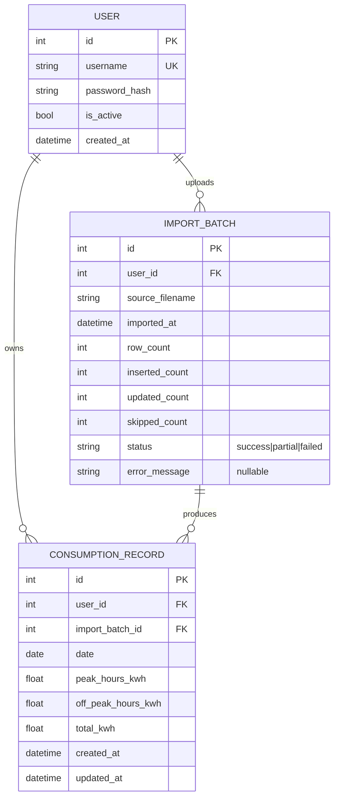

# Data model

## Entity-relationship diagram

## Tables

### `user`
- One row per human account. Created exclusively via the CLI (see
  [04-auth.md](./04-auth.md)).
- `password_hash`: Argon2id hash, never the plaintext.

### `import_batch`
- One row per CSV upload, kept for audit/rollback and to show import
  history in the UI.
- `status`: `success` (all rows processed), `partial` (some rows skipped,
  see `skipped_count` + `error_message` summary), `failed` (nothing
  committed).

### `consumption_record`
- One row per **day** per user.
- **Unique constraint**: `(user_id, date)`. Re-importing a CSV that
  contains a date already present **updates** that row (see import
  strategy in [03-csv-import.md](./03-csv-import.md)) rather than creating
  a duplicate.
- `total_kwh` is stored as provided by the source file rather than always
  recomputed as `hp + hc`, because the sample export shows the two are not
  always consistent (see edge cases doc). The discrepancy is only used for
  a data-quality warning at import time, never to silently override the
  authoritative total from the source.

## Indexes

- Composite index on `(user_id, date)` — used for both the uniqueness
  constraint and all range queries (month/year filters), so no additional
  index is needed.
- Index on `import_batch.user_id` for the import-history list.

## Derived data (not persisted, computed on read)

All of the following are computed on demand by the aggregation service
(pandas) from `consumption_record`, scoped to the requesting user:

- Daily/weekly/monthly/annual totals, peak/off-peak split and percentages.
- Month vs N-1 (same month, previous year) comparison.
- Rolling 30-day average and deviation, used to flag "unusual days".
- CO2 estimate: `total_kwh * CO2_FACTOR_G_PER_KWH / 1000`, where
  `CO2_FACTOR_G_PER_KWH` is a configurable setting (default: French grid
  average, adjustable via `.env`).
- Year-to-date cumulative curve and a simple forecast: current year's
  daily rate applied to the previous year's monthly shape (same method
  shown in the reference PDF), recomputed on the fly — not stored.

Keeping these derived values out of the database avoids stale caches and
keeps the schema minimal; if performance becomes an issue for large
histories, a materialized `monthly_summary` table can be added later
(see [08-roadmap.md](./08-roadmap.md)).
