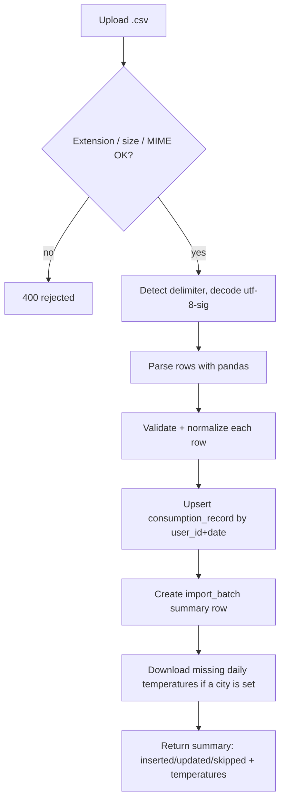

# CSV import

## Source format

Observed from the provided sample export (`sample copy.csv`), consistent
with a typical French smart-meter / supplier consumption export:

```
Énergie,Date,Heures Pleines,Heures Creuses,Consommation totale
Électricité,16/10/2024,2.143 kWh,0.857 kWh,2.143 kWh
Électricité,17/10/2024,0.714 kWh,0.286 kWh,0.714 kWh
...
```

- Delimiter: comma (auto-detected at import time — see below, some
  exports of this kind use `;` or tab instead).
- Encoding: read as `utf-8-sig` to tolerate a BOM (common in French
  exports), fallback to `latin-1` if decoding fails.
- Date format: `dd/mm/yyyy`.
- Numeric columns: formatted as `"<number> kWh"` (space-separated unit
  suffix), decimal separator is a dot. Some rows only show one decimal
  digit, others up to three — this is just precision, not a different
  format.
- `Énergie` column is currently always `Électricité` — kept but not
  strictly validated, to allow future gas/water exports without a schema
  change (extra energy types ignored for now, logged as skipped).
- **Known quirk**: the real sample file's **header row is tab-delimited
  while every data row is comma-delimited** (verified with `od -c` on the
  raw bytes) — an artifact of however the export was produced. Because of
  this, columns are matched by **fixed position**, not by header name (see
  below); the header line is only skipped, never parsed for field names.

## Column mapping (source → model)

The source file's headers are French (as exported by the meter/supplier
portal). Columns are mapped to the English `consumption_record` fields
(see [02-data-model.md](./02-data-model.md)) by **fixed position** (not by
matching the header's column names — see the delimiter quirk above), so no
French name ever reaches the code or the database:

| Position | Source column | Model field |
|---|---|---|
| 0 | `Énergie` | *(not stored, validated then dropped)* |
| 1 | `Date` | `date` |
| 2 | `Heures Pleines` | `peak_hours_kwh` |
| 3 | `Heures Creuses` | `off_peak_hours_kwh` |
| 4 | `Consommation totale` | `total_kwh` |

## Parsing rules

1. **Detect delimiter** among `,`, `;`, `\t` from the **first data row**
   (row 2), not the header — the header alone isn't reliable given the
   quirk above. A row with fewer than 5 columns is skipped.
2. **Strip unit suffix**: parse numeric cells with a regex
   `^\s*([\d.]+)\s*kWh\s*$` → `float`. Reject the row (log, skip, don't
   fail the whole batch) if a numeric cell doesn't match.
3. **Parse date** with `dd/mm/yyyy`; reject the row if invalid.
4. **Validate**: all three numeric values must be `>= 0`. If
   `abs(total_kwh - (peak_hours_kwh + off_peak_hours_kwh)) > 0.05`
   (tolerance), record a data-quality warning on the batch but still
   store the file's own `total_kwh` value as-is (it's the authoritative
   meter reading).
5. **Upsert by `(user_id, date)`**: if a date already exists for that
   user, **update** the existing row (last import wins) and increment
   `updated_count`; otherwise insert and increment `inserted_count`.

## Known edge case: duplicate dates within the same file

The sample file contains the **same date range appearing twice**, once
with full precision (e.g. `4.946 kWh,6.614 kWh,11.56 kWh`) and once later
in the file with rounded values (e.g. `4.9 kWh,6.6 kWh,11.5 kWh`) — this
looks like two exports of overlapping periods concatenated together.

Rule: **process rows in file order, last occurrence for a given date
wins**, exactly like the cross-import upsert rule above. This is simple,
predictable, and consistent whether the duplicate comes from the same
file or a re-upload. The exact number of such collisions is reported in
the post-import summary (`updated_count` also counts intra-file
overwrites, not only cross-import ones).

## Import flow



- The whole import runs in a **single DB transaction**: either the batch
  row + all upserts commit together, or nothing is committed and
  `status=failed` with `error_message` set (e.g. unreadable file).
  Per-row issues (bad date, bad number) are **skipped individually** and
  counted in `skipped_count`, they don't fail the transaction.
- Limits: max upload size (e.g. 5 MB — far more than needed for daily
  data over many years) and `.csv` extension enforced before parsing.
- After a non-failed import, if the user has a city configured, daily
  temperatures are downloaded for imported days that don't have one yet
  (see [01-architecture.md](./01-architecture.md#weather-data)). This runs
  after the import is committed: a weather-service failure only shows a
  warning, it never rolls back the import.

## Export

`GET /export` downloads all of the authenticated user's records, sorted
by date, in the **same format as the source file** (UTF-8 with BOM,
comma-delimited, French header, `dd/mm/yyyy`, `"<number> kWh"` cells,
`Énergie` always `Électricité`), so an export can be re-imported as-is.

## Out of scope for v1

- Other energy types (gas, water) — column is read but rows with
  `Énergie != Électricité` are skipped and counted.
- Sub-daily (hourly/half-hourly) granularity — the target export is daily.
