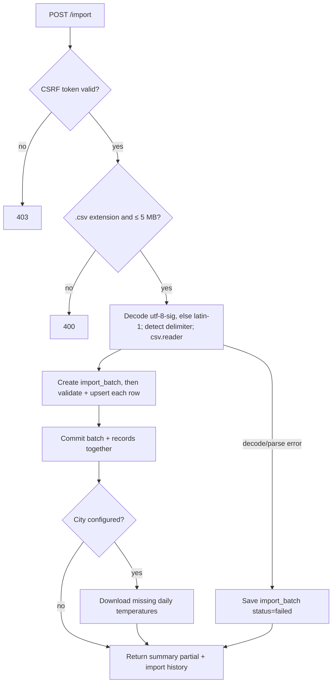

# CSV import

Implementation: `app/services/csv_import.py` (parsing + upsert),
`app/routers/imports.py` (upload route). Test fixtures with the formats
below live in `tests/fixtures/`.

## Source format

A typical French smart-meter / supplier daily consumption export:

```
Énergie,Date,Heures Pleines,Heures Creuses,Consommation totale
Électricité,16/10/2024,2.143 kWh,0.857 kWh,2.143 kWh
Électricité,17/10/2024,0.714 kWh,0.286 kWh,0.714 kWh
...
```

- Delimiter: comma, semicolon or tab (auto-detected, see below).
- Encoding: decoded as `utf-8-sig` (tolerates a BOM, common in French
  exports), falling back to `latin-1` if that fails.
- Date format: `dd/mm/yyyy`.
- Numeric columns: `"<number> kWh"` with a dot as decimal separator. The
  number of decimals varies (precision only, not a different format).
- **Known quirk**: real exports have been seen with a **tab-delimited
  header but comma-delimited data rows** (see
  `tests/fixtures/sample_mixed_delimiter.csv`). That's why columns are
  matched by **fixed position**, and the header line is skipped, never
  parsed for field names.

## Column mapping (source → model)

The French headers never reach the code or the database: columns map to
the English `consumption_record` fields (see
[02-data-model.md](./02-data-model.md)) by position.

| Position | Source column | Model field |
|---|---|---|
| 0 | `Énergie` | *(checked, not stored)* |
| 1 | `Date` | `date` |
| 2 | `Heures Pleines` | `peak_hours_kwh` |
| 3 | `Heures Creuses` | `off_peak_hours_kwh` |
| 4 | `Consommation totale` | `total_kwh` |

## Parsing rules

1. **Detect the delimiter** by counting `,`, `;` and `\t` in the
   **second physical line** (the first data row; the first line if
   there's only one) and picking the most frequent (comma on a tie). The
   whole text is then read with `csv.reader` and the first row (header)
   is dropped.
2. **Skip** (count in `skipped_count`) any row that:
   - has fewer than 5 columns (blank lines included);
   - has a non-empty `Énergie` other than `Électricité` (other energy
     types are out of scope; an empty cell is accepted);
   - has a date that doesn't parse as `dd/mm/yyyy`;
   - has a numeric cell not matching `^\s*([\d.]+)\s*kWh\s*$` (so negative
     values are rejected too).
   Skipped rows aren't logged individually.
3. **Consistency check**: if
   `abs(total_kwh − (peak_hours_kwh + off_peak_hours_kwh)) > 0.05`, the
   row is still stored with the file's own `total_kwh` (the authoritative
   meter reading), and the batch's `error_message` notes how many rows
   were inconsistent.
4. **Upsert by `(user_id, date)`**: an existing date is **updated** (and
   re-linked to the new batch), incrementing `updated_count`; otherwise
   the row is inserted, incrementing `inserted_count`.

Known limitation: a cell like `1..2 kWh` matches the regex but fails the
float conversion, which is not caught and aborts the request with a
server error instead of skipping the row.

## Duplicate dates within the same file

Real exports can contain the **same date range twice** (e.g. once with
full precision, once rounded) — typically two overlapping exports
concatenated.

Rule: **rows are processed in file order and the last occurrence of a
date wins**, exactly like the cross-import upsert rule. Intra-file
overwrites are counted in `updated_count` too.

## Import flow



- The batch row and all upserts are committed **in one transaction** at
  the end, so a file is never half-imported. Per-row problems are skipped
  and counted, they don't fail the batch.
- If the file can't be decoded or parsed, a `failed` batch with the error
  message is saved and nothing else is written.
- Limits: `.csv` extension (case-insensitive) and 5 MB (5 × 1024 × 1024
  bytes) are checked before parsing — far more than years of daily data.
- After a non-failed import, if the user has a city configured, the
  temperatures of **every** consumption day that has none yet are
  downloaded (see [01-architecture.md](./01-architecture.md#weather-data)).
  This happens after the commit: a weather-service failure only adds a
  warning to the summary.

## Export

`GET /export` (`app/services/csv_export.py`) downloads all of the
authenticated user's records as `spark-export-YYYY-MM-DD.csv`, sorted by
date, in the **same format as the source file**: UTF-8 with BOM,
comma-delimited, French header, `dd/mm/yyyy`, `"<number> kWh"` cells and
`Énergie` always `Électricité`. An export can be re-imported as-is.

## Out of scope for now

- Other energy types (gas, water): rows with another `Énergie` value are
  skipped and counted.
- Sub-daily (hourly/half-hourly) granularity — the target export is daily.
